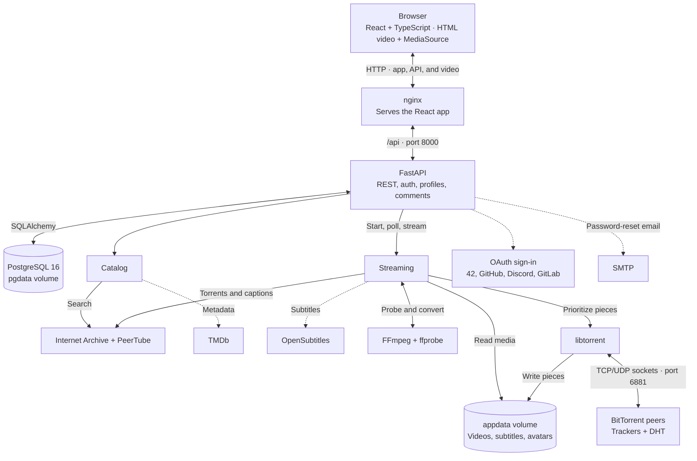

# Hypertube

Hypertube is a self-hosted movie discovery and streaming application. It searches Internet Archive and configurable PeerTube instances, downloads videos over BitTorrent, and starts playback before downloads finish.

## Design

[](design/Hypertube%20Preview.pdf)

The design covers 15 desktop and mobile screens, including account access, library search, movie details, playback, and settings. [Open the editable FigCraft file](design/Hypertube.figcraft).

Sample film artwork is by Blender Studio and the Blender Foundation. The artwork is cropped and shown in the app layout. [Blender Open Movies](https://studio.blender.org/films/) · [Spring poster](https://commons.wikimedia.org/wiki/File:Spring2019AlphaPosterBlender.jpg) · [CC BY 4.0](https://creativecommons.org/licenses/by/4.0/)

## Features

- Search and filter the library, and browse movie details, cast, and ratings.
- Play and seek through partial downloads, with on-the-fly conversion and subtitles.
- Manage profiles, leave comments, and track watch history. The app cleans up unwatched cached downloads.
- Use the interface in English, French, or Spanish, or access the REST API with a bearer token.

## How to run

Install Docker with Compose and `make`, then clone the repository and copy the environment file.

```sh
git clone https://github.com/mtellami/Hypertube.git
cd Hypertube
cp .env.example .env
```

Set a strong random `SECRET_KEY` and `POSTGRES_PASSWORD` in `.env`. If you deploy to a domain, set `PUBLIC_URL` to the public address and terminate HTTPS at a reverse proxy. Configure SMTP for password-reset emails. See [.env.example](.env.example) for optional integrations.

```sh
make prod
```

With the default `.env` settings, open the [app](http://localhost:8080) or [API docs](http://localhost:8080/api/docs). Use `make logs` to follow logs and `make down` to stop the stack while keeping its data.

## Architecture

Docker Compose runs nginx, FastAPI, and PostgreSQL. The FastAPI container also runs libtorrent and FFmpeg.



libtorrent downloads pieces from peers and HTTP web seeds. The player polls download status over HTTP and uses byte ranges for native playback. For conversion, FFmpeg reads completed files from disk or fetches partial files from FastAPI over loopback HTTP, then streams fragmented MP4 back to the browser through nginx.
